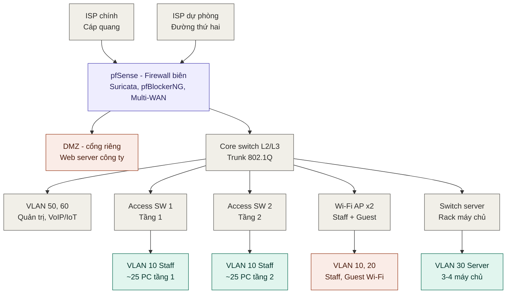
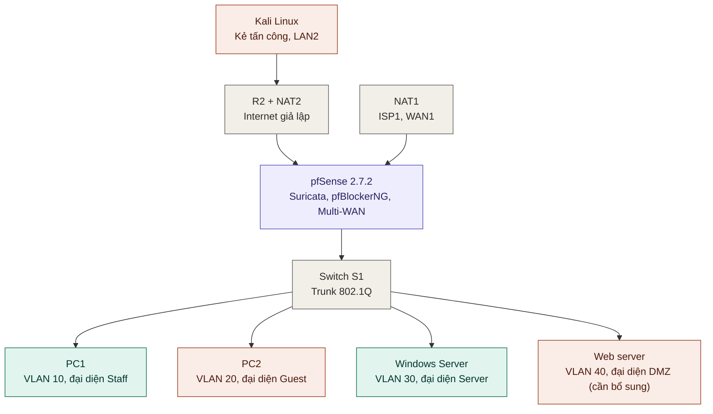

# pfSense NGFW cho doanh nghiệp vừa và nhỏ (SME)

Báo cáo thực tập cơ sở: **Nghiên cứu tường lửa thế hệ mới pfSense và ứng dụng trong doanh nghiệp vừa và nhỏ**.

Repo này mô tả **mô hình mạng doanh nghiệp (~60 máy)** và **mô hình GNS3 thu nhỏ** dùng để kiểm thử.

> **Nguyên tắc:** mô hình doanh nghiệp là mô hình chính. GNS3 chỉ là mô hình đại diện (prototype) để kiểm chứng giải pháp ở Chương 4.

## 1. Bài toán doanh nghiệp

Công ty X (giả định): dịch vụ và tư vấn, 1 trụ sở, khoảng 60 máy trạm và khoảng 25 thiết bị phụ (≈ 85–100 địa chỉ IP).

| Mã | Yêu cầu | Biện pháp |
|---|---|---|
| YC1 | Internet không gián đoạn | Multi-WAN failover |
| YC2 | Tách phòng ban, khách, máy chủ | VLAN + ACL |
| YC3 | Dịch vụ công khai không làm lộ mạng nội bộ | DMZ |
| YC4 | Phát hiện và chặn quét/khai thác | Suricata |
| YC5 | Chặn IP/domain độc hại | pfBlockerNG (IP + DNSBL) |
| YC6 | Kiểm soát nội dung, chống lách DoH/DoT | DNSBL + rule port 853/53 |
| YC7 | Ưu tiên họp trực tuyến | Traffic Shaper (chỉ cấu hình) |
| YC8 | Có log để truy vết | Log Suricata, pfBlockerNG, firewall |

## 2. Hình A: mô hình mạng doanh nghiệp (mô hình chính)



Chú giải: xanh lá là mạng nội bộ tin cậy, cam là vùng ít tin cậy (Guest, DMZ), xám là hạ tầng, tím là firewall biên.

### Phân vùng mạng (địa chỉ đề xuất)

| Vùng | VLAN | Subnet | Quy mô | Vai trò |
|---|---|---|---|---|
| Staff | 10 | 192.168.10.0/24 | ~50 PC/laptop | Làm việc hằng ngày |
| Guest | 20 | 192.168.20.0/24 | ~10 thiết bị | Khách, chỉ ra web/DNS |
| Server | 30 | 192.168.30.0/24 | 3–4 máy chủ | AD, file, kế toán |
| DMZ | cổng riêng (hoặc 40) | 192.168.40.0/24 | 1 web server | Dịch vụ công khai |
| Quản trị | 50 | 192.168.50.0/24 | switch, AP, UPS | Quản trị thiết bị |
| VoIP/IoT | 60 | 192.168.60.0/24 | điện thoại, camera, máy in | Gắn với QoS |

### Ma trận luồng giữa các vùng (chính sách đề xuất)

| Từ \ Đến | Internet | DMZ | Server | Staff | Guest |
|---|---|---|---|---|---|
| **Internet** | - | Chỉ TCP 80/443 | Chặn | Chặn | Chặn |
| **Staff** | Cho phép (qua DNSBL) | 80/443 | Chỉ cổng cần thiết (SMB 445, DNS 53) | - | Chặn |
| **Guest** | Chỉ web, DNS | Chặn | Chặn | Chặn | - |
| **Server** | Chỉ cập nhật | Chặn | - | Chặn chủ động | Chặn |
| **DMZ** | Chỉ cập nhật | - | Chặn | Chặn | Chặn |

## 3. Hình B: mô hình GNS3 (chỉ dùng để kiểm thử ở Chương 4)



## 4. Ánh xạ doanh nghiệp ↔ GNS3

| Doanh nghiệp thật | Nút GNS3 | Ghi chú |
|---|---|---|
| ISP chính (IP công cộng) | NAT1 | WAN1 nhận IP qua DHCP |
| ISP dự phòng + Internet | R2 + NAT2 | WAN2 |
| Kẻ tấn công từ Internet | Kali (LAN2) | Chỉ có khi kiểm thử |
| Firewall biên + IDS/IPS + lọc DNS | pfSense | Suricata, pfBlockerNG |
| Core/access switch | Switch S1 | Trunk 802.1Q, cổng access |
| ~50 máy Staff | PC1 | 1 node đại diện cả VLAN |
| Wi-Fi khách | PC2 | 1 node đại diện VLAN Guest |
| Cụm máy chủ nội bộ | Windows Server | VLAN 30 |
| Web công khai | Web server | VLAN 40 (cần bổ sung) |
| Wi-Fi AP, điện thoại, camera, máy in | (không mô phỏng) | Ngoài phạm vi |

## 5. Kịch bản kiểm thử (Chương 4)

| Yêu cầu | Kịch bản | Tiêu chí đạt | Trạng thái |
|---|---|---|---|
| YC1 | Ngắt WAN1, ping liên tục | Chuyển WAN2, mất gói ≤ 5 giây | Điền sau khi test |
| YC2 | Guest/Staff truy cập Server theo ma trận luồng | Đúng chính sách | Điền sau khi test |
| YC3 | Kali truy cập web DMZ; DMZ truy cập Server | 80/443 qua, vùng nội bộ bị chặn | Điền sau khi test |
| YC4 | Nmap từ Kali vào DMZ | Có alert của Suricata | Điền sau khi test |
| YC5 | Truy cập IP thuộc Feodo Tracker | Có log chặn trong pfBlockerNG | Điền sau khi test |
| YC6 | `nslookup`, truy cập mạng xã hội, thử DoT/DoH | Trả về Virtual IP; DoT bị chặn | Điền sau khi test |
| YC7 | Không đo | Ghi nhận là hạn chế | - |
| YC8 | Đối chiếu log của YC4–YC6 | Có bản ghi tương ứng | Điền sau khi test |

## 6. Phạm vi và giới hạn của GNS3

- **Dùng được để đánh giá:** tính đúng đắn logic (VLAN/ACL, failover, chữ ký Suricata, DNSBL).
- **Không dùng để kết luận:** throughput, độ trễ tuyệt đối, CPU/RAM thực tế, số người dùng đồng thời (GNS3 chạy trên ảo hóa lồng nhau).
- **Không mô phỏng:** Wi-Fi AP, VPN từ xa, email gateway, antivirus/endpoint, backup, SIEM.

## 7. Tài liệu tham khảo

- Cisco, *Small Enterprise Design Profile Reference Guide*: https://www3-realm.cisco.com/en/US/docs/solutions/Enterprise/Small_Enterprise_Design_Profile/chap1.html
- Cisco, *LAN Baseline Architecture Overview - Branch Office Network*: https://www3-realm.cisco.com/en/US/docs/solutions/Enterprise/Branch/Overview.pdf
- Cisco, *Cisco SAFE Solution Overview*: https://www3-realm.cisco.com/en/US/docs/solutions/Enterprise/Security/SAFESolOver.pdf
- Cisco Meraki, *Reference Architecture - Small Office Business*: https://documentation.meraki.com/Platform_Management/Dashboard_Administration/Design_and_Configure/Architectures_and_Best_Practices/Meraki_Reference_Architecture_-_Small_Office_Business
- ipfyi, *Network Design for Small Business*: https://ipfyi.com/guides/subnetting-mastery/network-design-small-business/
- Dell, *Networking Small Business Reference Architecture 1.0*: https://www.netsolutionworks.com/datasheets/FY16Q1_217_Dell_Networking_SBRA_Solution_Brief_041015.pdf
- GIAC, *VLANs: Contribution to Perimeter Defence*: https://www.giac.org/paper/gcfw/560/vlans-contribution-perimeter-defence-secure-network-architecture-giac-enterpri/107105
- NIST SP 800-41 Rev. 1, *Guidelines on Firewalls and Firewall Policy*: https://doi.org/10.6028/NIST.SP.800-41r1
- Netgate, *pfSense Documentation*: https://docs.netgate.com/pfsense/en/latest/

> Ghi chú: các tài liệu của Cisco/Meraki/Dell/ipfyi là kiến trúc tham chiếu của nhà cung cấp, không phải sơ đồ nội bộ của một công ty cụ thể. Cần bổ sung ngày truy cập khi đưa vào báo cáo.

## 8. Cấu trúc repo đề xuất

```text
.
├── README.md          # tài liệu này
├── docs/              # báo cáo PDF, hình xuất từ draw.io/GNS3
├── configs/           # cấu hình xuất từ pfSense (đã xóa mật khẩu)
└── evidence/          # ảnh chụp kết quả kiểm thử Chương 4
```
